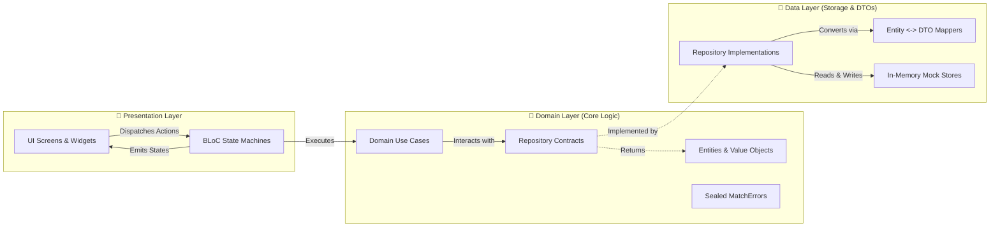

# 🎾 SetPoint — Mobile Tennis Matchmaking & Court Platform

[](https://flutter.dev)
[](https://dart.dev)
[](https://blog.cleancoder.com/uncle-bob/2012/08/13/the-clean-architecture.html)
[](https://bloclibrary.dev)
[](#-testing--code-quality)
[](.github/workflows/deploy.yml)
[](LICENSE)

> A production-grade mobile tennis matchmaking and court booking platform for Buenos Aires players, built with **Flutter**, **Dart 3**, **Clean Architecture**, **BLoC (Action-Based)**, and a custom **Dark Glassmorphism** design system.

---

## 🚀 Live Interactive Demo

Test the live application directly in your browser:

🔗 **[Launch SetPoint Live Web Demo](https://tobishakur.github.io/flutter-tennis-matchmaking/)**

> 💡 *On desktop browsers, the app renders in an adaptive responsive frame alongside a developer showcase card, simulating the exact touch experience and proportions of a mobile device.*

---

## 🎯 The Problem & The Solution

- **The Problem:** Organizing tennis matches is notoriously painful. Players waste time coordinating across messaging apps, dealing with mismatched skill levels, incompatible court surfaces, and last-minute dropouts without a reliable queue or moderation system.
- **The Solution:** SetPoint streamlines match discovery into a real-time, location-aware experience. Players can filter games within a 5–20 km radius, match by verified skill level, choose between Clay, Hard, or Grass courts, visualize tactical team formations, and communicate in dedicated match chat rooms.

---

## 🏛️ Architecture & Data Flow

The project strictly follows **Clean Architecture** combined with **Action-Based BLoC State Management** to enforce unidirectional data flow, separation of concerns, and high testability:



### Architectural Pillars
- **Strict Dart 3 Typing:** Domain error hierarchies modeled as `sealed class MatchError extends Equatable` with exhaustive pattern matching.
- **Dependency Inversion (DIP):** Presentation and Domain depend only on abstract repository contracts, never on concrete implementations.
- **Deterministic Offline Resilience:** In-memory mock repositories with realistic simulated network latency (200–500ms) and zero paid cloud API dependencies.
- **Session Decoupling:** Global user identity (`AppConstants.currentUserId`) is isolated from theme design tokens and presentation widgets.

---

## ✨ Key Engineering Features

1. **🏟️ Tactical Court Formation Visualizer:**
   - Real-time team visualization for 1v1 Singles and 2v2 Doubles.
   - Dynamic court themes adjusting palette and textures based on actual surface:
     - **Clay / Polvo de ladrillo** (Earthy brick red)
     - **Hard / Cemento** (Deep tournament blue)
     - **Grass / Césped** (Vibrant lawn green)
   - Organizer controls for match editing and instant cancellation.

2. **🔍 Multi-Criteria Real-Time Filtering:**
   - Orthogonal filters for game mode, court surface, 5-tier player levels, and search radius slider (5 km – 20 km with 1 km precision).
   - "All" quick-chip resets all categories and snaps radius back to the 10 km baseline.
   - Reactive badge counter on AppBar displaying total active criteria.

3. **🗺️ Interactive Map & Viewport Clustering:**
   - OpenStreetMap integration via `flutter_map` and `latlong2`.
   - Proximity clustering with smooth fly-to zoom animations and zero coordinate jitter.
   - Interactive location picker with reverse coordinate mapping for creating matches.

4. **💬 Match Chat & UGC Safety (App Store Compliance):**
   - Access-controlled chat rooms limited to joined match participants.
   - Real-time UGC moderation: own-message deletion, content reporting modal, user blocking, and instant message redaction across the app.
   - Dedicated management screen to review and unblock users.

5. **🛡️ Resilient Date Formatter:**
   - Custom formatting engine (`AppDateFormatter`) delivering clean localized outputs ("Today, HH:mm", "Tomorrow", short dates) with zero risk of web `LocaleDataException` crashes.

---

## 📂 Project Structure

Mirrored clean architecture layout between production code and the test suite:

```
tenis_app/
├── .github/workflows/deploy.yml       # Automated CI/CD GitHub Pages workflow
├── assets/images/
│   ├── icons/                         # SVG vectors and branding assets
│   └── stock/                         # High-res tennis imagery
├── lib/
│   ├── core/
│   │   ├── constants/app_constants.dart
│   │   ├── theme/app_theme.dart       # Dark Glassmorphism design tokens
│   │   ├── utils/date_formatter.dart  # Resilient date engine
│   │   └── widgets/desktop_showcase_wrapper.dart
│   ├── features/
│   │   ├── chat/                      # Chat domain, data & BLoC with UGC
│   │   ├── matches/                   # Matches, tactical court, filters & map
│   │   ├── onboarding/                # Carousel and welcome flow
│   │   └── profile/                   # Player profile, stats & user blocking
│   └── main.dart                      # Application entry point
└── test/
    ├── core/utils/date_formatter_test.dart
    └── features/
        ├── chat/presentation/bloc/chat_bloc_test.dart
        └── matches/
            ├── domain/usecases/calcular_relevancia_partido_test.dart
            └── presentation/
                ├── bloc/matches_bloc_test.dart
                └── screens_rendering_test.dart
```

---

## 🧪 Testing & Code Quality

The codebase includes comprehensive unit, domain use case, BLoC state, and widget rendering tests:

```bash
flutter test
```

### Test Suite Summary (24/24 Passing)
- ✅ **Date Formatter Tests**: Validates relative dates, 24-hour formats, zero-padding, and crash resilience.
- ✅ **Chat BLoC UGC Tests**: Validates message deletion, report flow, and immediate user blocking redaction.
- ✅ **Domain Use Case Tests**: Validates heuristic match relevance calculations (`CalcularRelevanciaPartido`).
- ✅ **Matches BLoC Tests**: Validates sorted feed emissions, `MatchErrorCanchaCompleta` typed error handling, and organizer updates.
- ✅ **Widget Rendering Tests**: Verifies core screens (MyMatches, MatchDetail, Profile, Edit) render without layout overflows under MultiBlocProvider.

---

## 🛠️ Local Development

### Prerequisites
- [Flutter SDK](https://docs.flutter.dev/get-started/install) (v3.22.0 or higher)
- Dart SDK (v3.4.0 or higher)

### Setup & Run
```bash
# 1. Clone repository
git clone https://github.com/TobiShakur/flutter-tennis-matchmaking.git
cd flutter-tennis-matchmaking

# 2. Install dependencies
flutter pub get

# 3. Verify code quality & tests
dart format --output=none --set-exit-if-changed .
flutter analyze
flutter test

# 4. Launch on Chrome or connected device
flutter run -d chrome
```

---

## 🤖 CI/CD Pipeline

The project features a zero-cost automated GitHub Actions pipeline (`.github/workflows/deploy.yml`):
1. Triggers on every push to `main`.
2. Validates code formatting with `dart format`.
3. Runs static analysis with `flutter analyze` (0 issues threshold).
4. Executes the full test suite (`flutter test`).
5. Builds the production release web bundle (`flutter build web --release`).
6. Deploys automatically to **GitHub Pages**.

---

## 👤 Author

**Tobías Gutiérrez** — *Mobile Software Engineer*
- Computer Science & Engineering student at **FIUBA** (Facultad de Ingeniería, Universidad de Buenos Aires).
- Specialized in Flutter, Clean Architecture, BLoC, and high-performance cross-platform mobile apps.
- GitHub: [@TobiShakur](https://github.com/TobiShakur)

---

## 📄 License

This project is licensed under the MIT License — see the [LICENSE](LICENSE) file for details.
