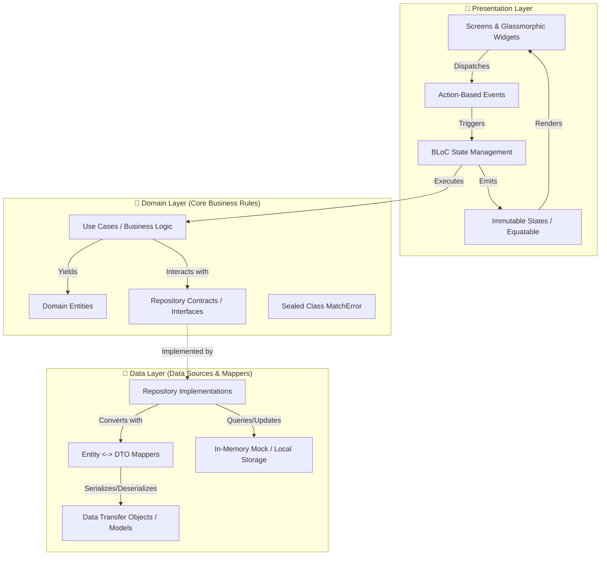

# 🎾 SetPoint — Mobile Tennis Matchmaking & Court Platform

[](https://flutter.dev)
[](https://dart.dev)
[](https://blog.cleancoder.com/uncle-bob/2012/08/13/the-clean-architecture.html)
[](https://bloclibrary.dev)
[](#-testing--quality-assurance)
[](.github/workflows/deploy.yml)
[](LICENSE)

> **SetPoint** es una aplicación móvil moderna desarrollada en Flutter y Dart 3 para conectar tenistas amateur y competitivos en la Ciudad de Buenos Aires. Diseñada bajo principios estrictos de **Clean Architecture**, **BLoC Pattern (Action-Based)** y un **Design System Dark Glassmorphism** de alto impacto visual.

---

## 🚀 Live Demo en la Web

Podés probar la aplicación directamente desde tu navegador en GitHub Pages:

🔗 **[Ver Demo en Vivo (Web)](https://tobishakur.github.io/flutter-tennis-matchmaking/)**

> 💡 *En navegadores de escritorio, la aplicación renderiza en un contenedor adaptativo centrado (`max-width: 460px`) simulando la experiencia móvil nativa con scroll elástico táctil.*

---

## ✨ Features Destacadas

### 1. 🏟️ Visualizador Táctico de Cancha
- Renderizado interactivo de formación de equipos en cancha (1v1 Singles y 2v2 Dobles).
- 3 variantes cromáticas y temáticas dinámicas según la superficie real:
  - **Polvo de ladrillo** (Rojo arcilla terroso)
  - **Cemento / Hard Court** (Azul deep court)
  - **Césped** (Verde pasto vibrante)
- Panel de administración exclusivo para el creador del partido (edición completa y cancelación/borrado).

### 2. 🔍 Sistema de Filtrado Multi-Criterio en Tiempo Real
- Filtrado ortogonal e instantáneo por:
  - **Modalidad**: Singles (2J) o Dobles (4J).
  - **Superficie**: Polvo de ladrillo, Cemento, Césped.
  - **Nivel del Jugador**: Principiante, Básico, Intermedio, Avanzado, Experto (con selección múltiple inteligente y agrupación automática de "Todos").
  - **Radio de Búsqueda**: Slider continuo con resolución de 1 km (de 5 km a 20 km) y quick-chips de acceso rápido.
- Insignia reactiva con el conteo de filtros activos en AppBar y botones con micro-feedback háptico.

### 3. 🗺️ Mapa Interactivo & Smart Clustering
- Integración con OpenStreetMap vía `flutter_map` y `latlong2`.
- Agrupamiento inteligente de partidos por proximidad con conteo visual en chip neón.
- Animación fluida de zoom (`fly-to`) al seleccionar canchas o clusters individuales.
- Selector interactivo de ubicación al crear partidos con sincronización bidireccional de coordenadas y geocodificación descriptiva.

### 4. 💬 Chat Grupal & Moderación UGC (App Store Compliance)
- Sala de chat dedicada para cada partido con acceso restringido únicamente a participantes confirmados.
- Suite de seguridad y moderación en cumplimiento con las guías de Apple App Store / Google Play:
  - Eliminación de mensajes propios.
  - Reporte de contenido inapropiado con clasificación contextual.
  - Bloqueo de usuarios ofensivos con redacción y filtrado en tiempo real en todo el feed y chat.
  - Pantalla de gestión y desbloqueo de usuarios bloqueados.

### 5. 🛡️ Resiliencia Offline y Cero Mantenimiento
- Repositorio mock en memoria con simulación de latencia realista (200-500ms).
- **Cero costo operativo:** No requiere facturación de Firebase ni claves de API pagas. La experiencia completa es 100% autónoma y funcional lista para evaluar.
- Formateador de fechas resiliente (`AppDateFormatter`) independiente de paquetes con dependencias locales rotas (`LocaleDataException`).

---

## 🏛️ Arquitectura & Buenas Prácticas

El proyecto sigue una estructura estricta de **Clean Architecture** combinada con **BLoC (Action-based)**:



### Principios Clave Aplicados
- **Dart 3 Strict Typing:** Uso extensivo de `sealed class` para jerarquías de error (`MatchError`), `pattern matching` y records.
- **Inversión de Dependencias (DIP):** Los BLoCs y Casos de Uso dependen exclusivamente de abstracciones (`Repository Contracts`), nunca de implementaciones concretas.
- **Inmutabilidad Absoluta:** Estados y entidades modelados con `Equatable` y métodos `copyWith`.
- **Desacoplamiento de Sesión:** `AppConstants.currentUserId` totalmente separado de la capa de presentación y del tema visual (`AppTheme`).

---

## 📂 Estructura del Proyecto

El árbol de directorios refleja el diseño en capas y cuenta con una suite de pruebas en espejo:

```
tenis_app/
├── .github/
│   └── workflows/
│       └── deploy.yml             # Pipeline CI/CD GitHub Pages
├── assets/
│   └── images/
│       ├── icons/                 # Iconos SVG y branding
│       └── stock/                 # Imágenes de alta resolución de tenis
├── lib/
│   ├── core/
│   │   ├── animations/            # Smoke page transitions
│   │   ├── constants/             # AppConstants (userId, defaults)
│   │   ├── theme/                 # AppTheme (Dark Glassmorphism)
│   │   └── utils/                 # AppDateFormatter (Zero-exception)
│   ├── features/
│   │   ├── chat/                  # BLoC, Data & Domain de mensajería y UGC
│   │   ├── matches/               # Core de partidos, filtros, mapa y cancha
│   │   ├── onboarding/            # Flujo de bienvenida y carrusel
│   │   └── profile/               # Perfiles, estadísticas y bloqueo de usuarios
│   └── main.dart                  # Entry point con responsive container
└── test/
    ├── core/
    │   └── utils/
    │       └── date_formatter_test.dart
    └── features/
        ├── chat/
        │   └── presentation/bloc/chat_bloc_test.dart
        └── matches/
            ├── domain/usecases/calcular_relevancia_partido_test.dart
            └── presentation/
                ├── bloc/matches_bloc_test.dart
                └── screens_rendering_test.dart
```

---

## 🧪 Testing & Calidad de Código

El repositorio cuenta con una cobertura exhaustiva que abarca tests unitarios, de use cases, de BLoC con `bloc_test` y widget testing:

```bash
flutter test
```

### Resultados de la Suite (24/24 Passing)
- ✅ **Date Formatter Tests**: Validación de formato relativo, 24 horas y prevención de `LocaleDataException`.
- ✅ **Chat BLoC UGC Tests**: Borrado de mensajes, reporte y bloqueo reactivo de usuarios.
- ✅ **Domain UseCase Tests**: Heurística de relevancia de partidos (`CalcularRelevanciaPartido`).
- ✅ **Matches BLoC Tests**: Carga de feed, manejo de errores tipados (`MatchErrorCanchaCompleta`), actualización y cancelación.
- ✅ **Widget Rendering Tests**: Integridad visual de pantallas críticas bajo MultiBlocProvider sin errores de layout ni overflow.

---

## 🛠️ Instalación y Ejecución Local

### Prerrequisitos
- [Flutter SDK](https://docs.flutter.dev/get-started/install) (v3.22.0 o superior)
- Dart SDK (v3.4.0 o superior)

### Pasos
1. **Clonar el repositorio:**
   ```bash
   git clone https://github.com/TobiShakur/flutter-tennis-matchmaking.git
   cd flutter-tennis-matchmaking
   ```

2. **Instalar dependencias:**
   ```bash
   flutter pub get
   ```

3. **Verificar calidad de código:**
   ```bash
   dart format --output=none --set-exit-if-changed .
   flutter analyze
   flutter test
   ```

4. **Ejecutar en tu dispositivo o emulador:**
   ```bash
   # En navegador Chrome
   flutter run -d chrome

   # En dispositivo Android o iOS
   flutter run
   ```

5. **Compilar para producción Web:**
   ```bash
   flutter build web --release --base-href "/flutter-tennis-matchmaking/"
   ```

---

## 🤖 CI/CD Automatizado

El proyecto incluye un pipeline automatizado con **GitHub Actions** (`.github/workflows/deploy.yml`):
- Se dispara en cada `push` a la rama `main`.
- Ejecuta `dart format`, `flutter analyze` y `flutter test`.
- Compila la versión web con `--base-href "/<repo-name>/"`.
- Despliega automáticamente en **GitHub Pages** sin costo ni servidores externos.

---

## 👤 Autor

**Tobías Shakur** — *Mobile & Flutter Software Engineer*
- Estudiante de Ingeniería en Informática (FIUBA).
- Especializado en Flutter, Clean Architecture, BLoC y desarrollo de aplicaciones móviles de alto rendimiento.

---

## 📄 Licencia

Este proyecto está bajo la Licencia MIT. Consulta el archivo `LICENSE` para más detalles.
